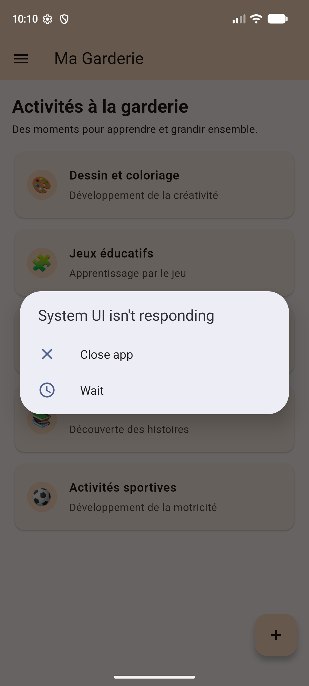
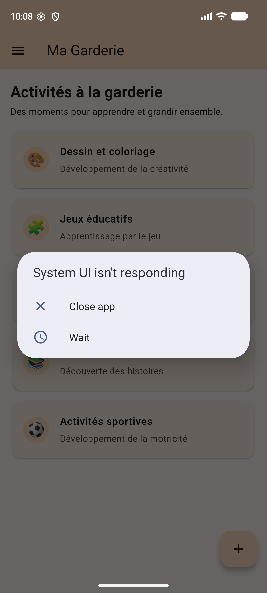

# Ma Garderie

Ma Garderie est une application mobile Flutter de présentation des activités
d'une garderie. Elle accueille les familles avec un écran de démarrage, puis
présente une liste locale d'activités éducatives et ludiques. Les interactions
sont simulées dans l'application : aucun backend, base de données ou compte
n'est nécessaire.

## Fonctionnalités

- Écran de démarrage illustré, avec redirection automatique après 3 secondes.
- Page d'accueil avec une liste de cinq activités affichant leur icône, titre et
  description.
- Menu de navigation proposant **Accueil**, **Activités** et **À propos**.
- Bouton **+** et sélection d'une activité avec retour visuel dans un SnackBar.
- Données des activités déclarées directement dans le code.

## Technologies

- Flutter et Dart
- Material 3
- Tests d'interface avec `flutter_test`

## Prérequis

- Flutter installé et configuré (`flutter doctor`)
- Un émulateur Android/iOS ou un appareil connecté

## Installation et lancement

Depuis la racine du dépôt :

```sh
flutter pub get
flutter run
```

Pour cibler un appareil particulier, listez les appareils avec `flutter devices`,
puis lancez `flutter run -d <device-id>`.

## Vérification

```sh
flutter analyze
flutter test
```

## Captures d'écran

### Écran de démarrage



### Page principale et liste des activités


### Menu de navigation ouvert


### Message après une interaction



## Historique des étapes Git

Chaque fonctionnalité a été développée sur sa propre branche `feature/*` ou
`docs/*`, puis fusionnée dans `main` :

- `feature/init-project` — initialisation du projet Flutter.
- `feature/splash-screen` — écran de démarrage.
- `feature/home-page` — structure de la page principale.
- `feature/list-view` — liste statique des activités.
- `feature/interactions` — navigation et retours SnackBar.
- `docs/readme` — documentation et captures d'écran.
